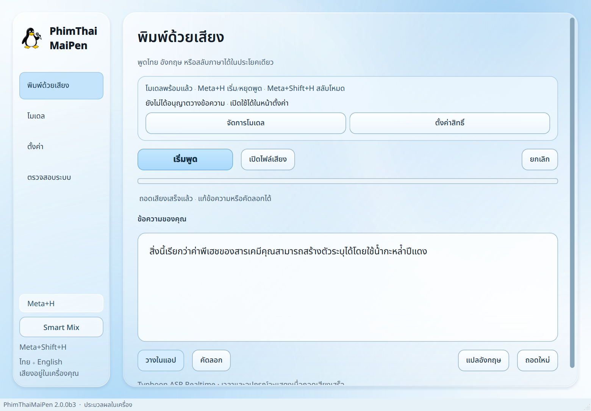

# PhimThaiMaiPen 2.0 · พิมพ์ไทยไม่เป็น


แอปพิมพ์ด้วยเสียงไทย–อังกฤษสำหรับ Linux กด `Meta+H` พูด กดอีกครั้ง แล้วข้อความจะถูกวางลงแอปที่ใช้อยู่ ถอดเสียงและแปลในเครื่องทั้งหมดหลังดาวน์โหลดโมเดล

**Local Thai and English voice typing for Linux** — press Meta+H, speak, press again, and the text is pasted into the focused app. Speech never leaves your computer.

- ค่าเริ่มต้น: **Typhoon ASR Realtime** (~462 MB) + Smart Mix + CPU + วางทันที / Default: Typhoon ASR Realtime, Smart Mix, CPU, immediate paste
- **Qwen3-ASR** (ไทย อังกฤษ ภาษาผสม) เป็นตัวเลือกเสริม ดาวน์โหลดเองในหน้าโมเดล / Qwen is an optional download
- ทดสอบหลักบน **Fedora 44 KDE Plasma / Wayland / x86_64** · GPU/NPU ยังเป็น Beta
- หน้าตา Liquid Glass ตามโทนไอคอน รองรับโหมดมืด ตัวอักษรไทยอ่านง่าย คอนทราสต์ระดับ WCAG AA ([branding](docs/BRANDING-ICE-GLASS.md))



## ติดตั้ง / Install

### Flatpak · แนะนำ / Recommended

ดาวน์โหลด `PhimThaiMaiPen-<version>-x86_64.flatpak` และ `SHA256SUMS` จากรุ่นล่าสุดใน [GitHub Releases](https://github.com/Tatarus9450/PhimThaiMaiPen/releases) แล้วเปิดด้วย **Discover** หรือ:

```bash
sha256sum --check --ignore-missing SHA256SUMS
flatpak install --user ./PhimThaiMaiPen-*-x86_64.flatpak
flatpak run --branch=beta io.github.tatarus9450.PhimThaiMaiPen
```

ยังไม่มีบน Flathub การอัปเดตคือติดตั้งไฟล์ `.flatpak` รุ่นใหม่ทับ (ออกจากแอปด้วย **Quit** ก่อน) การตั้งค่าและโมเดลอยู่ใน `~/.var/app/io.github.tatarus9450.PhimThaiMaiPen/` และคงอยู่หลังอัปเดต

> **ติดตั้งแบบเดียว** — อย่าติดตั้ง Flatpak ทั้งแบบ `--user` และ `--system` พร้อมกัน หรือใช้ร่วมกับรุ่น native เพราะปุ่มลัดจะชนกัน ดู[แก้ปัญหา](#แก้ปัญหา--troubleshooting) / Install only one copy.

### Native · สำหรับนักพัฒนา / For developers

ต้องมี Python 3.11–3.13 (venv), FFmpeg, `patch`, `pactl`, PulseAudio หรือ PipeWire-Pulse และ `xdg-desktop-portal` ของเดสก์ท็อป

```bash
git clone https://github.com/Tatarus9450/PhimThaiMaiPen.git
cd PhimThaiMaiPen
python3 scripts/install-app.py            # --python python3.12 / --intel (OpenVINO)
```

ตัวติดตั้งสร้าง `.venv-app` พร้อม PyTorch CPU, NeMo (Typhoon) และ Qwen runtime แล้วเพิ่ม launcher ในเมนู ไม่ใช้ sudo อัปเดตด้วย `git pull --ff-only && python3 scripts/install-app.py` ข้อมูลอยู่ที่ `~/.config/phimthai/` (settings) และ `~/.local/share/phimthai/` (โมเดล ประวัติ)

## เริ่มใช้ / First run

1. **ตัวช่วยเริ่มต้น** พาดาวน์โหลด Typhoon (~462 MB หยุด/โหลดต่อได้) เลือกไมค์ และตั้งปุ่มลัด
2. **ตอบหน้าขอสิทธิ์ของเดสก์ท็อป** สำหรับปุ่มลัดและการวางข้อความ
3. คลิกช่องข้อความปลายทาง กด `Meta+H` พูด แล้วกดอีกครั้ง Popup ด้านซ้ายแสดง กำลังเตรียม → ระดับเสียง → กำลังถอด → วางแล้ว/คัดลอกแล้ว โดยไม่แย่งโฟกัส
4. `Meta+Shift+H` สลับโหมด Smart Mix → Raw → TH → ENG ต้องการตรวจก่อนวาง: **ตั้งค่า → เมื่อพูดจบ**

- **ครั้งแรกช้า ครั้งต่อไปเร็ว** — worker โหลดโมเดลค้างไว้ (เริ่มโหลดตั้งแต่เริ่มพูด) ครั้งต่อไปไม่ต้องรอ cold start ~19 วินาที และคืน RAM หลังว่าง 5 นาที / The model stays warm and is released after 5 idle minutes.
- พูดซ้ำได้ระหว่างที่งานก่อนหน้ายังประมวลผล งานใหม่จะเข้าคิว
- การตั้งค่าบันทึกอัตโนมัติ เปลี่ยนปุ่มลัดได้ด้วยการกดปุ่มที่ต้องการ หน้า **Diagnostics** มีรายการตรวจระบบ
- เปิดไฟล์เสียง (WAV, MP3, FLAC, OGG, M4A), Retry, Undo และแปลไทย → อังกฤษในเครื่องได้จากหน้าต่างหลัก

## โมเดลและอุปกรณ์ / Models and devices

| Model | สถานะ / Status |
| --- | --- |
| Typhoon ASR Realtime · เบาที่สุด | ไทย; ค่าเริ่มต้น ~462 MB, CC-BY-4.0 |
| Qwen3-ASR 0.6B · ดีที่สุด | ไทย/อังกฤษ/ผสม; ~1.89 GB, RAM สูงสุดราว 5.3–6 GiB บน CPU |
| Qwen3-ASR 1.7B | ~4.71 GB; ยังไม่ยืนยันบนเครื่องทดสอบ |
| Whisper OpenVINO (Tiny/Turbo INT8) | CPU ผ่าน; Intel GPU/NPU ยังไม่ทดสอบ |
| Whisper Turbo Q5 · Vulkan / AMD NPU | ทดลอง ต้องติดตั้ง runtime เพิ่ม ([HARDWARE](docs/HARDWARE.md)) |
| OPUS Thai → English | แปลในเครื่อง ควรตรวจคำแปล |

ไฟล์โมเดลตรึง revision ตรวจ hash ตอนดาวน์โหลด และตรวจความสมบูรณ์ซ้ำก่อนใช้ นำเข้าโฟลเดอร์ Qwen SafeTensors / Whisper OpenVINO / GGML Q5 ได้จาก **โมเดล → นำเข้า** · Auto ใช้ CPU; GPU/NPU มีป้าย Beta สีแดง · ดู [Compatibility](docs/COMPATIBILITY.md)

## ความเป็นส่วนตัว / Privacy

- ไม่ส่งเสียงหรือข้อความออกนอกเครื่อง ประวัติเสียงและข้อความ **ปิดเป็นค่าเริ่มต้น**
- เสียงล่าสุดเก็บชั่วคราวเพื่อ Retry และลบเมื่อออกจากแอป
- การวางคืนเนื้อหาคลิปบอร์ดเดิมหลังวาง และบอก Klipper ไม่ให้เก็บข้อความชั่วคราว

## การวางบน Wayland / Wayland paste

Wayland ไม่ให้แอปพิมพ์ใส่แอปอื่นโดยตรง และไม่ให้แอปที่ไม่ได้โฟกัสตั้งคลิปบอร์ด แอปจึงวางเป็นขั้น:

1. ใส่ข้อความในคลิปบอร์ด — ถ้า Qt ตั้งไม่ได้เพราะไม่ได้โฟกัส จะใช้ **`wl-copy`** (data-control protocol; มีใน Flatpak แล้ว รุ่น native ติดตั้งแพ็กเกจ `wl-clipboard`)
2. ส่ง Ctrl+V ผ่าน **RemoteDesktop portal** (อนุญาตครั้งแรก) ใช้ตำแหน่งปุ่มจริง จึงวางได้ทั้งแป้นไทยและอังกฤษ
3. ถ้าวางไม่ได้ ข้อความยัง **คัดลอกไว้และแจ้งเตือน** ให้กด Ctrl+V เอง

Popup ใช้ XWayland/XCB เพื่อกำหนดตำแหน่งและไม่แย่งโฟกัส จึงต้องมี XWayland

## แก้ปัญหา / Troubleshooting

**Log และรายงานปัญหา** — หน้า Diagnostics มีปุ่ม **คัดลอกรายงานปัญหา** แนบมากับ [issue](https://github.com/Tatarus9450/PhimThaiMaiPen/issues) ได้เลย Log อยู่ที่:

- Native: `~/.local/state/phimthai/logs/phimthai.log`
- Flatpak: `~/.var/app/io.github.tatarus9450.PhimThaiMaiPen/.local/state/phimthai/logs/phimthai.log`

**ติดตั้งซ้ำสองชุด / Duplicate installs** — ตรวจและลบชุดที่เกิน:

```bash
flatpak list --app | grep -i phimthai
flatpak uninstall --system io.github.tatarus9450.PhimThaiMaiPen   # เก็บรุ่น --user ไว้
```

**Meta+H ทำงานสองครั้งหรือไม่ทำงาน / Duplicate shortcut**

- Native (KDE): `.venv-app/bin/python -m phimthai.kde --doctor` เพื่อตรวจ และ `--remove-service-shortcuts` เพื่อล้างปุ่มลัดที่ลงทะเบียนซ้ำ
- Flatpak: **System Settings → Keyboard → Shortcuts** ลบรายการ PhimThaiMaiPen ที่ซ้ำ แล้วกด **เปิดใช้ปุ่มลัด** ในหน้าตั้งค่าของแอป

| อาการ | วิธีแก้ |
| --- | --- |
| ไม่มีเสียง / ไมค์หลุด | ตั้งค่า → เลือกไมค์ → ทดสอบไมค์ |
| พูดแล้วไม่มีข้อความ | ตรวจระดับเสียงใน Popup หรือปิด VAD |
| วางไม่ได้ | อนุญาตสิทธิ์วางในตั้งค่า หรือกด Ctrl+V เองหลังแจ้งเตือน "คัดลอกแล้ว" |
| ดาวน์โหลดค้าง / ไฟล์โมเดลเสีย | หน้าโมเดล → ดาวน์โหลดหรือซ่อมแซม |
| การตั้งค่าเสีย | แอปซ่อมให้อัตโนมัติและเก็บไฟล์เดิมเป็น backup ข้างไฟล์ settings |
| ช้า / RAM ไม่พอ | ใช้ Typhoon หรือลด CPU threads ในตั้งค่า |

ถอนรุ่น native: ลบ `~/.local/share/applications/io.github.tatarus9450.PhimThaiMaiPen.desktop`, `~/.local/share/phimthai/bin/phimthai` และ `.venv-app`

## พัฒนาและทดสอบ / Development

```bash
.venv-app/bin/pip install --no-deps --no-build-isolation -e .
.venv-app/bin/pip install pytest            # หรือ pip install -e '.[dev]'
QT_QPA_PLATFORM=offscreen .venv-app/bin/python -m pytest -q tests test_asr_backend.py
```

`phimthai/` คือแอป worker และตัวจัดการโมเดล `typhoon_service.py` คือแกน ASR ที่ใช้ร่วมกัน ผลทดสอบอยู่ใน [IMPLEMENTATION.md](docs/IMPLEMENTATION.md) และ [`docs/evidence/`](docs/evidence/) การสร้างแพ็กเกจและแผนแจกจ่ายดู [DISTRIBUTION.md](docs/DISTRIBUTION.md) · รุ่นเดิม: [LEGACY.md](docs/LEGACY.md)

## License

ตัวแอปใช้ [MIT](LICENSE) โมเดลและไลบรารีใช้สิทธิ์ของแต่ละโครงการ ดู [SOURCE_BUILD_MATRIX.md](docs/SOURCE_BUILD_MATRIX.md)
